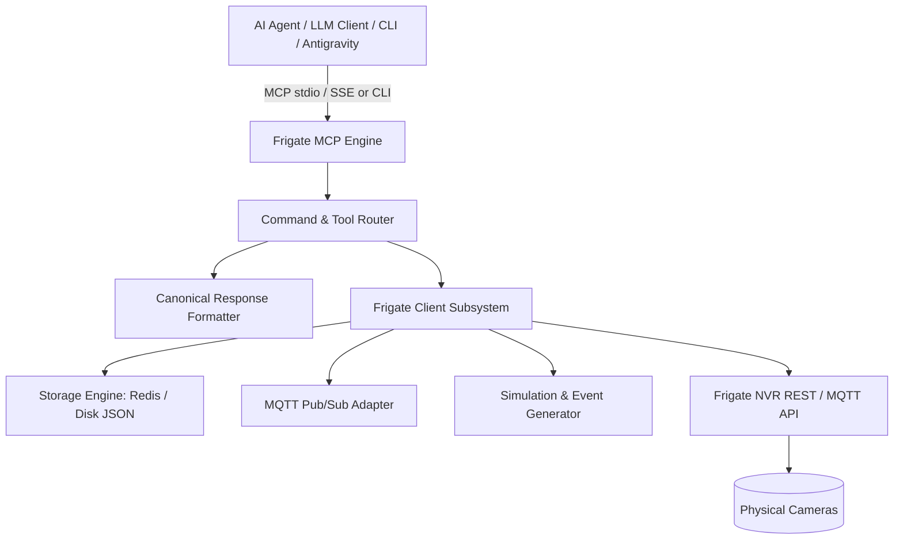

# Frigate-MCP System Architecture and Design

## 1. Overview

Frigate-MCP connects the Frigate NVR ecosystem with AI agents, automated workflows, and CLI tools using the open Model Context Protocol (MCP). It abstracts multi-camera complexity and exposes discovery, PTZ steering, snapshot captures, recording toggles, image processing controls, and AI object detection events over standardized JSON protocols.

## 2. Architecture Diagram



## 3. Core Subsystems

### 3.1 Model Context Protocol Layer (`app/mcp_server.py`)
- **Protocol**: MCP v2.x using `mcp.server.MCPServer`.
- **Transports**:
  - **stdio**: Standard IO pipe for local LLM tools (Antigravity, Claude Desktop, Cursor).
  - **SSE**: Server-Sent Events over HTTP on port 5000 (Starlette/Uvicorn), ideal for Docker container setups and networked agents.
- **MCP Primitives**:
  - **Tools (38 Tools)**: Camera controls, discovery, recording, PTZ, sensor tuning, and object detection event queries (`get_events`, `get_event_picture`, `get_event_clip`, `retain_event`).
  - **Resources**: `frigate://cameras`, `frigate://cameras/{camera_id}/settings`, `frigate://events`, `frigate://status`.
  - **Prompts**: `camera_audit`, `security_sweep`.

### 3.2 Frigate Client & Communication (`app/frigate.py`)
- Interfaces with Frigate NVR REST endpoints (`/api/version`, `/api/config`, `/api/events`, `/api/{cam}/latest.jpg`, `/api/{cam}/ptz`, etc.).
- **Automatic Fallback & Simulation**: When physical Frigate instances are unavailable (e.g. CI/CD, local development, tests), the client operates in simulation mode with full parameter persistence, camera state tracking, valid JPEG generation, and realistic event records.

### 3.3 State Persistence Engine (`app/storage.py`)
- **Dual-Tier Storage**: Automatically connects to Redis (configured in `docker-compose.yml`) with seamless fallback to disk storage (`./data/cameras_state.json`).
- **Process Isolation Resilience**: Ensures camera settings, PTZ positions, and toggles persist across distinct CLI invocations, Docker restarts, and multi-worker (`workers=4`) deployments.

### 3.4 MQTT Integration (`app/mqtt.py`)
- Publishes real-time camera state changes and commands to Frigate MQTT topics (`frigate/<camera_id>/motion/set`, `frigate/<camera_id>/ptz`, etc.).
- Listens to Frigate event streams and camera triggers (`frigate/events`, `frigate/+/motion`).
- Operates in offline/simulated mode when an external broker is not present.

### 3.5 Command & Status Code Dispatcher (`app/commands.py`)
- Implements canonical response contract:
  ```json
  {
    "status": "success",
    "message": "Operation completed successfully",
    "status_code": 200,
    "data": { ... }
  }
  ```
- Standardized HTTP status codes:
  - `200`: Success
  - `400`: Bad Request (parameter validation errors, invalid levels)
  - `401`: Unauthorized
  - `403`: Forbidden
  - `404`: Not Found (missing camera_id or event_id)
  - `500`: Internal Server Error

### 3.6 CLI & Server Entrypoint (`app/main.py`)
- Command parser handling both server lifecycle (`serve`, `start`, `stop`, `status`, `restart`) and direct camera/event interactions (`list`, `picture`, `events`, `event-picture`, `pan`, `brightness`, etc.).
- Clean JSON stdout guarantees scriptability with tools like `jq`.

## 4. Security & Isolation
- Pure Python execution with sandbox compatibility.
- Containerized deployment with non-privileged ports and read-only volume capabilities.
